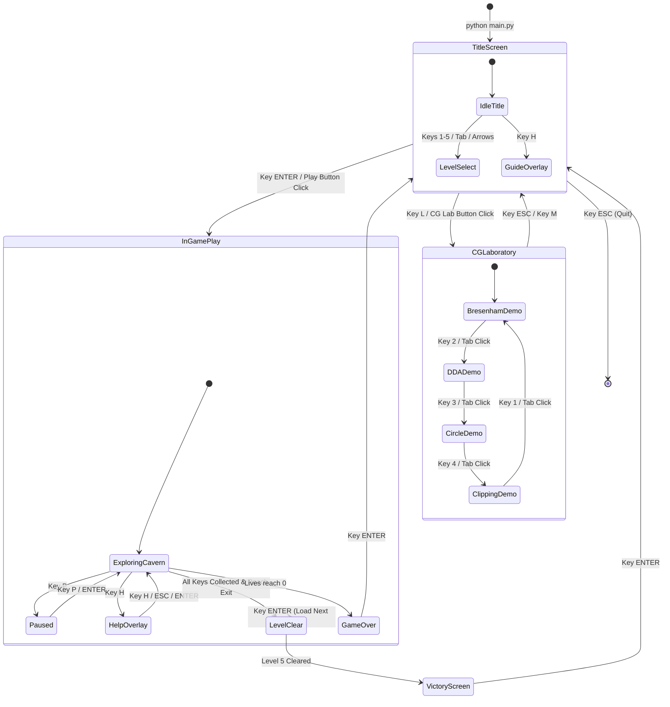
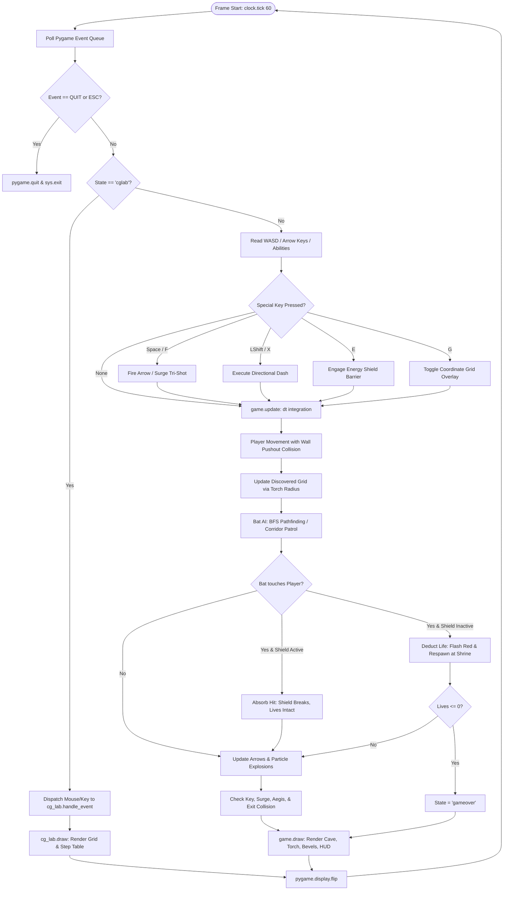
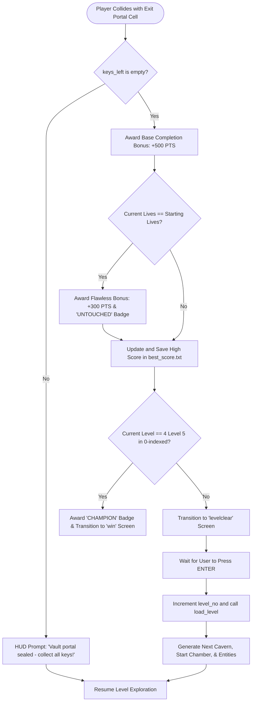
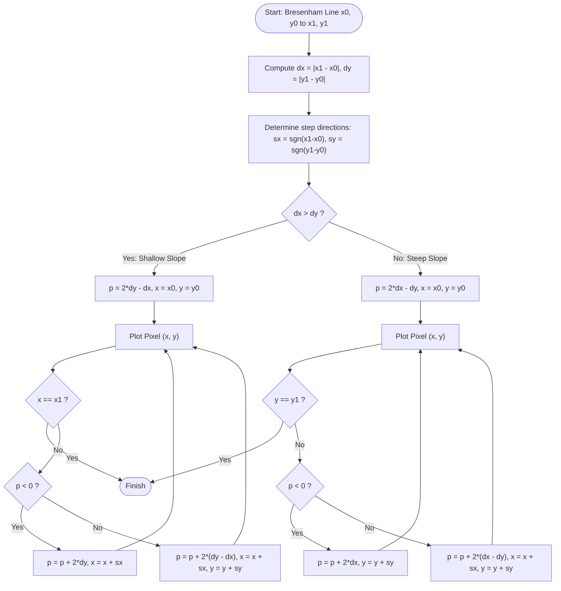

# EmberVault: The Crystal Maze - Project Diagrams & System Architecture

This document contains visual diagrams in GitHub-compatible Mermaid markdown syntax illustrating the system architecture, application lifecycle, game loop, level progression, and computer graphics algorithms implemented in **EmberVault: The Crystal Maze**.

---

## 1. System Architecture Diagram

This diagram displays the high-level architecture of the project, showing how the entry point, rendering engine, homogeneous transformation pipeline, level generator, and Computer Graphics Laboratory interact.

```mermaid
graph TD
    A[main.py: Application Entry Point & Pygame Window Init] --> B[game.py: Game State Manager & Engine]
    
    subgraph "Core Game & Simulation Engine"
        B --> C[levels.py: Level & Maze Generator]
        B --> D[matrix.py: 3x3 Homogeneous Transformations]
        B --> E[graphics.py: Core Rasterization & Clipping Library]
        B --> F[cg_lab.py: Interactive CG Laboratory Mode]
        B --> P[best_score.txt: Local Persistence File]
    end

    subgraph "Level & Agent Subsystem"
        C --> C1[DFS Maze Carving with Random Seed]
        C --> C2[Corridor Loop Injection]
        C --> C3[BFS Distance Map & Topological Pathfinding]
        C --> C4[Bat Entity: Stalker BFS AI & Scout Patrol AI]
    end

    subgraph "Graphics Pipeline Subsystem"
        E --> E1[Bresenham & DDA Line Algorithms]
        E --> E2[Midpoint Circle Outline & Scanline Spans]
        E --> E3[Cohen-Sutherland & Liang-Barsky Clipping]
        E --> E4[Scan-line Concave Polygon Fill]
        E --> E5[Renderer: Torch Rectangular Clip Window]
    end

    subgraph "Matrix Transformation Engine"
        D --> D1[translate: Position Offsets]
        D --> D2[rotate: Aiming & Spread Matrices]
        D --> D3[scale: Pulse & Mirror Flaps]
        D --> D4[compose & apply: 3x3 Affine Products]
    end

    subgraph "Interactive CG Laboratory Subsystem"
        F --> F1[Bresenham Discrete Grid & Step Parameter Table]
        F --> F2[DDA Incremental Floating Step Table]
        F --> F3[Midpoint Circle 8-Way Symmetry Color-Coded Octants]
        F --> F4[Cohen-Sutherland 4-Bit Outcode Decision Tree]
    end
```



---

## 2. Application Startup & State Machine Flowchart

This flowchart traces how the application initializes, transitions between menus, gameplay, overlays, and the Computer Graphics Laboratory.



---

## 3. Game Loop Engine Flowchart

This flowchart shows the per-frame processing cycle running at 60 FPS in `main.py` and `game.py`.



---

## 4. Level Progression & Flawless Clear Flowchart

This flowchart explains the logic evaluated when the player arrives at the exit portal of a cavern.



---

## 5. Computer Graphics Algorithm Flowcharts & Diagrams

### 5.1 Bresenham's Line Algorithm Logic Flowchart



---

### 5.2 Midpoint Circle 8-Way Symmetry Octant Diagram

The midpoint circle algorithm computes pixels only for Octant 1 ($x \le y$) and mirrors each point across the 8 symmetrical octants around center $(cx, cy)$:

```text
                           (-y, x)      (y, x)
                               \   |   /
                                \  |  /
                                 \ | /
                   (-x, y) ------- C ------- (x, y)
                                 / | \
                                /  |  \
                               /   |   \
                          (-y, -x)  |   (y, -x)
                                (-x, -y)
```

| Octant | Coordinate Formulation | CG Lab Symmetry Color |
|---|---|---|
| **Octant 1** | $(cx + x, cy - y)$ | Neon Green (`#39ff14`) |
| **Octant 2** | $(cx + y, cy - x)$ | Electric Cyan (`#00ebff`) |
| **Octant 3** | $(cx + y, cy + x)$ | Purple Void (`#912dd7`) |
| **Octant 4** | $(cx + x, cy + y)$ | Amber Gold (`#ffcd2d`) |
| **Octant 5** | $(cx - x, cy + y)$ | Coral Red (`#eb4854`) |
| **Octant 6** | $(cx - y, cy + x)$ | Light Cyan (`#50f0ff`) |
| **Octant 7** | $(cx - y, cy - x)$ | Lavender (`#d278ff`) |
| **Octant 8** | $(cx - x, cy - y)$ | Mint (`#78ffa0`) |

---

### 5.3 Cohen-Sutherland 4-Bit Region Outcodes Diagram

The 2D plane is divided into 9 regions using 4-bit binary outcodes `[TOP, BOTTOM, RIGHT, LEFT]`:

```text
        1001 (Top-Left)     |  1000 (Top)     |  1010 (Top-Right)
                            |                 |
        --------------------+-----------------+--------------------  y_max
        0001 (Left)         |  0000 (INSIDE)  |  0010 (Right)
                            |  [Clip Window]  |
        --------------------+-----------------+--------------------  y_min
        0101 (Bottom-Left)  |  0100 (Bottom)  |  0110 (Bottom-Right)
                            |                 |
                          x_min             x_max
```

```mermaid
flowchart TD
    CS_Start([Start: Line P0, P1 and Clip Window]) --> CalcCodes["Compute 4-bit Outcodes c0 and c1"]
    CalcCodes --> TestTrivialAccept{c0 | c1 == 0000?}
    TestTrivialAccept -- Yes --> Accept["Trivially Accept Line: Entirely Inside Window"]
    Accept --> CS_Done([Return Clipped Segment])

    TestTrivialAccept -- No --> TestTrivialReject{c0 & c1 != 0000?}
    TestTrivialReject -- Yes --> Reject["Trivially Reject Line: Entirely on One Side Outside Window"]
    Reject --> CS_DoneNone([Return None: Completely Invisible])

    TestTrivialReject -- No --> SelectEndpoint["Pick outside endpoint: c_out = c0 if c0 != 0 else c1"]
    SelectEndpoint --> IntersectEdge{Determine Bit set in c_out}
    IntersectEdge -- TOP (Bit 3) --> CutTop["x = x0 + (x1-x0)*(y_max - y0)/(y1 - y0), y = y_max"]
    IntersectEdge -- BOTTOM (Bit 2) --> CutBottom["x = x0 + (x1-x0)*(y_min - y0)/(y1 - y0), y = y_min"]
    IntersectEdge -- RIGHT (Bit 1) --> CutRight["y = y0 + (y1-y0)*(x_max - x0)/(x1 - x0), x = x_max"]
    IntersectEdge -- LEFT (Bit 0) --> CutLeft["y = y0 + (y1-y0)*(x_min - x0)/(x1 - x0), x = x_min"]

    CutTop --> UpdateEndpoint["Replace (x0, y0) or (x1, y1) with intersection (x, y)"]
    CutBottom --> UpdateEndpoint
    CutRight --> UpdateEndpoint
    CutLeft --> UpdateEndpoint
    UpdateEndpoint --> CalcCodes
```
