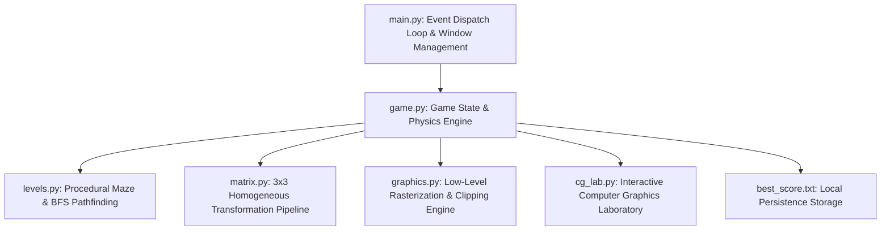
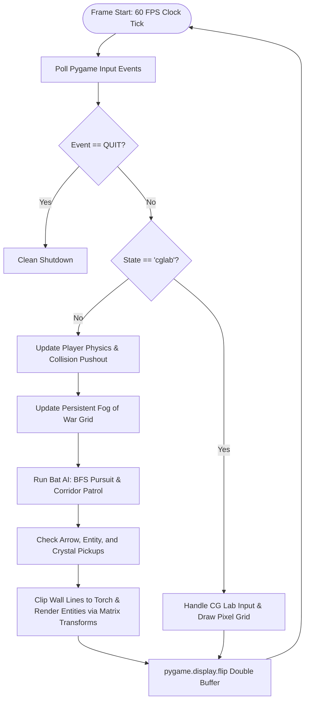

# PROJECT REPORT ON
# EMBERVAULT: THE CRYSTAL MAZE
### A 2D Computer Graphics Cave-Exploration Game & Interactive Graphics Laboratory

---

**Submitted in partial fulfillment of the requirements for the degree of**  
**BACHELOR OF TECHNOLOGY / BACHELOR OF ENGINEERING**  
**IN**  
**INFORMATION TECHNOLOGY / COMPUTER SCIENCE & ENGINEERING**

---

**Submitted by:**  
**[STUDENT NAME]**  
**Roll No. / Registration No.: [ROLL NUMBER]**

**Under the Guidance of:**  
**[PROFESSOR / GUIDE NAME]**  
[Designation of Guide]  
Department of [Department Name]

---

**DEPARTMENT OF [DEPARTMENT NAME]**  
**[INSTITUTION / UNIVERSITY NAME]**  
**[CITY, STATE, PIN CODE]**  
**ACADEMIC YEAR: [2025 – 2026]**

---

<div style="page-break-after: always;"></div>

## CERTIFICATE OF APPROVAL

This is to certify that the project entitled **"EmberVault: The Crystal Maze"** is a bona fide record of work carried out by **[STUDENT NAME]** (Roll No: **[ROLL NUMBER]**) in partial fulfillment of the requirements for the award of the degree of **Bachelor of Technology / Engineering in [Department Name]** from **[Institution / University Name]** during the academic year **[2025 – 2026]**.

The project report has been approved as it satisfies the academic requirements prescribed for the Computer Graphics Laboratory and Theory curriculum.

<br><br><br>

----------------------------------- &nbsp;&nbsp;&nbsp;&nbsp;&nbsp;&nbsp;&nbsp;&nbsp;&nbsp;&nbsp;&nbsp;&nbsp;&nbsp;&nbsp;&nbsp;&nbsp;&nbsp;&nbsp;&nbsp;&nbsp;&nbsp;&nbsp;&nbsp;&nbsp;&nbsp;&nbsp;&nbsp;&nbsp; -----------------------------------  
**[GUIDE NAME]** &nbsp;&nbsp;&nbsp;&nbsp;&nbsp;&nbsp;&nbsp;&nbsp;&nbsp;&nbsp;&nbsp;&nbsp;&nbsp;&nbsp;&nbsp;&nbsp;&nbsp;&nbsp;&nbsp;&nbsp;&nbsp;&nbsp;&nbsp;&nbsp;&nbsp;&nbsp;&nbsp;&nbsp;&nbsp;&nbsp;&nbsp;&nbsp;&nbsp;&nbsp;&nbsp;&nbsp;&nbsp;&nbsp;&nbsp;&nbsp;&nbsp;&nbsp;&nbsp;&nbsp;&nbsp;&nbsp;&nbsp;&nbsp;&nbsp;&nbsp;&nbsp;&nbsp;&nbsp; **[HEAD OF DEPARTMENT]**  
Project Guide &nbsp;&nbsp;&nbsp;&nbsp;&nbsp;&nbsp;&nbsp;&nbsp;&nbsp;&nbsp;&nbsp;&nbsp;&nbsp;&nbsp;&nbsp;&nbsp;&nbsp;&nbsp;&nbsp;&nbsp;&nbsp;&nbsp;&nbsp;&nbsp;&nbsp;&nbsp;&nbsp;&nbsp;&nbsp;&nbsp;&nbsp;&nbsp;&nbsp;&nbsp;&nbsp;&nbsp;&nbsp;&nbsp;&nbsp;&nbsp;&nbsp;&nbsp;&nbsp;&nbsp;&nbsp;&nbsp;&nbsp;&nbsp;&nbsp;&nbsp;&nbsp;&nbsp;&nbsp;&nbsp;&nbsp;&nbsp;&nbsp;&nbsp;&nbsp;&nbsp; Head of Department  
Department of [Department] &nbsp;&nbsp;&nbsp;&nbsp;&nbsp;&nbsp;&nbsp;&nbsp;&nbsp;&nbsp;&nbsp;&nbsp;&nbsp;&nbsp;&nbsp;&nbsp;&nbsp;&nbsp;&nbsp;&nbsp;&nbsp;&nbsp;&nbsp;&nbsp;&nbsp;&nbsp;&nbsp;&nbsp;&nbsp;&nbsp;&nbsp;&nbsp;&nbsp;&nbsp;&nbsp;&nbsp;&nbsp;&nbsp; Department of [Department]  
[Institution Name] &nbsp;&nbsp;&nbsp;&nbsp;&nbsp;&nbsp;&nbsp;&nbsp;&nbsp;&nbsp;&nbsp;&nbsp;&nbsp;&nbsp;&nbsp;&nbsp;&nbsp;&nbsp;&nbsp;&nbsp;&nbsp;&nbsp;&nbsp;&nbsp;&nbsp;&nbsp;&nbsp;&nbsp;&nbsp;&nbsp;&nbsp;&nbsp;&nbsp;&nbsp;&nbsp;&nbsp;&nbsp;&nbsp;&nbsp;&nbsp;&nbsp;&nbsp;&nbsp;&nbsp;&nbsp;&nbsp;&nbsp;&nbsp;&nbsp;&nbsp;&nbsp;&nbsp;&nbsp;&nbsp;&nbsp; [Institution Name]  

<br><br>

----------------------------------- &nbsp;&nbsp;&nbsp;&nbsp;&nbsp;&nbsp;&nbsp;&nbsp;&nbsp;&nbsp;&nbsp;&nbsp;&nbsp;&nbsp;&nbsp;&nbsp;&nbsp;&nbsp;&nbsp;&nbsp;&nbsp;&nbsp;&nbsp;&nbsp;&nbsp;&nbsp;&nbsp;&nbsp; -----------------------------------  
**INTERNAL EXAMINER** &nbsp;&nbsp;&nbsp;&nbsp;&nbsp;&nbsp;&nbsp;&nbsp;&nbsp;&nbsp;&nbsp;&nbsp;&nbsp;&nbsp;&nbsp;&nbsp;&nbsp;&nbsp;&nbsp;&nbsp;&nbsp;&nbsp;&nbsp;&nbsp;&nbsp;&nbsp;&nbsp;&nbsp;&nbsp;&nbsp;&nbsp;&nbsp;&nbsp;&nbsp;&nbsp;&nbsp;&nbsp;&nbsp;&nbsp;&nbsp;&nbsp;&nbsp; **EXTERNAL EXAMINER**  
Date: &nbsp;&nbsp;&nbsp;&nbsp;&nbsp;&nbsp;&nbsp;&nbsp;&nbsp;&nbsp;&nbsp;&nbsp;&nbsp;&nbsp;&nbsp;&nbsp;&nbsp;&nbsp;&nbsp;&nbsp;&nbsp;&nbsp;&nbsp;&nbsp;&nbsp;&nbsp;&nbsp;&nbsp;&nbsp;&nbsp;&nbsp;&nbsp;&nbsp;&nbsp;&nbsp;&nbsp;&nbsp;&nbsp;&nbsp;&nbsp;&nbsp;&nbsp;&nbsp;&nbsp;&nbsp;&nbsp;&nbsp;&nbsp;&nbsp;&nbsp;&nbsp;&nbsp;&nbsp;&nbsp;&nbsp;&nbsp;&nbsp;&nbsp;&nbsp;&nbsp;&nbsp;&nbsp;&nbsp;&nbsp;&nbsp;&nbsp;&nbsp;&nbsp;&nbsp;&nbsp;&nbsp;&nbsp;&nbsp; Date:  

---

<div style="page-break-after: always;"></div>

## ACKNOWLEDGEMENTS

I express my deepest sense of gratitude and sincere thanks to my project guide, **[PROFESSOR / GUIDE NAME]**, [Designation], Department of [Department Name], **[Institution Name]**, for invaluable guidance, encouragement, and constructive feedback throughout the design, development, and documentation of this Computer Graphics project.

I am also thankful to **[HEAD OF DEPARTMENT NAME]**, Head of the Department of [Department Name], for providing the academic infrastructure and computing laboratories required to complete this work.

Finally, I wish to thank my family, peers, and faculty members who directly or indirectly extended their support and assistance in completing **EmberVault: The Crystal Maze**.

<br>
**[STUDENT NAME]**  
Roll No: [ROLL NUMBER]  
Date: [DATE OF SUBMISSION]  

---

<div style="page-break-after: always;"></div>

## ABSTRACT

The rapid evolution of modern video games and graphics software has distanced students from foundational rasterization and computational geometry algorithms. Modern game engines (e.g., Unreal Engine, Unity) treat graphics as black-box abstractions, preventing undergraduate engineers from directly interacting with scanline converters, line clipping algorithms, and affine transformation matrices.

This project, **"EmberVault: The Crystal Maze,"** addresses this educational gap by developing a full-featured 2D computer graphics cave-exploration game and an interactive academic Computer Graphics Laboratory implemented entirely from mathematical scratch in Python using Pygame strictly for low-level pixel buffer display. 

The software implements the **Bresenham Line Algorithm** and **Digital Differential Analyzer (DDA)** for line rasterization, the **Midpoint Circle Algorithm** for outer key halos and scanline-filled circular primitives, **Cohen-Sutherland Line Clipping** and **Liang-Barsky Line Clipping** to dynamically clip cave geometry against a moving rectangular torch-light window, and a complete **$3 \times 3$ Homogeneous Matrix Transformation Pipeline** for translation, rotation, scaling, reflection, and shear.

Gameplay encompasses 5 procedurally generated, loop-injected caverns with circle-versus-cell pushout collision detection, dynamic fog of war, and intelligent enemy wraiths using Breadth-First Search (BFS) grid pathfinding. Adhering to a strict **Zero-Timer Design**, all cooldowns and ability charges (Directional Dash, Energy Shield, and Tri-Shot Spread Arrows) operate on discrete gameplay actions rather than countdown clocks. An integrated **Computer Graphics Laboratory mode** allows interactive examination of discrete pixel grids, decision parameters, and 8-way circle symmetry. The system is verified through an automated 16-test headless verification suite passing with 100% success.

---

<div style="page-break-after: always;"></div>

## TABLE OF CONTENTS

- **Certificate of Approval**
- **Acknowledgements**
- **Abstract**
- **List of Figures & Tables**
- **Chapter 1: Introduction**
  - 1.1 Project Title & Background
  - 1.2 Motivation & Problem Statement
  - 1.3 Proposed Solution & Objectives
  - 1.4 Scope & Intended Audience
- **Chapter 2: Project Overview**
  - 2.1 Game Narrative & User Experience
  - 2.2 Core Gameplay Loop
  - 2.3 Educational Value as a Computer Graphics Project
- **Chapter 3: Technologies Used**
  - 3.1 Python Programming Language
  - 3.2 Pygame Library
  - 3.3 Flat-File Local Persistence
  - 3.4 Python Standard Library Modules
- **Chapter 4: Computer Graphics Theory**
  - 4.1 Pixels, Raster Grids, and Cartesian Systems
  - 4.2 2D Rasterization & Scanline Conversion
  - 4.3 Clipping & Viewing Windows
  - 4.4 2D Affine Transformations & Homogeneous Coordinates
  - 4.5 Double Buffering & Frame Synchronization
- **Chapter 5: Computer Graphics Algorithms Implemented**
  - 5.1 Bresenham's Integer Line Drawing Algorithm
  - 5.2 Digital Differential Analyzer (DDA) Algorithm
  - 5.3 Midpoint Circle Drawing Algorithm & 8-Way Symmetry
  - 5.4 Cohen-Sutherland Line Clipping Algorithm
  - 5.5 Liang-Barsky Parametric Line Clipping Algorithm
  - 5.6 Concave Scan-Line Polygon Filling
  - 5.7 Breadth-First Search (BFS) Grid Pathfinding
- **Chapter 6: System Design and Architecture**
  - 6.1 Architectural Overview & Module Interaction
  - 6.2 Application State Machine
  - 6.3 Game Loop & Rendering Pipeline
  - 6.4 Data Flow & Level Transition Architecture
- **Chapter 7: Step-by-Step Code Explanation**
  - 7.1 Startup & Pygame Window Creation (`main.py`)
  - 7.2 Low-Level Graphics Primitives (`graphics.py`)
  - 7.3 Affine Transformation Pipeline (`matrix.py`)
  - 7.4 Maze Generation & Enemy AI (`levels.py`)
  - 7.5 Game State & Physics Engine (`game.py`)
  - 7.6 Standalone CG Laboratory Subsystem (`cg_lab.py`)
- **Chapter 8: Gameplay Features & Zero-Timer Design**
  - 8.1 5 Procedural Cavern Mazes
  - 8.2 Energy Shield Ability
  - 8.3 Directional Dash Ability
  - 8.4 Crystal Power-Ups (Cyan Surge & Violet Aegis)
  - 8.5 Intelligent Stalker & Scout Enemy AI
  - 8.6 Dynamic Fog of War & Vault Radar
  - 8.7 Badges, Scoring, and Persistence
- **Chapter 9: User Interface & Controls**
  - 9.1 Title Screen & Level Showcase
  - 9.2 Heads-Up Display (HUD) Design
  - 9.3 In-Game Field Guide & Overlays
  - 9.4 Complete Keyboard Controls Reference
- **Chapter 10: Testing & Verification**
  - 10.1 Automated Verification Methodology
  - 10.2 Comprehensive Test-Case Verification Matrix
  - 10.3 Results Analysis & Edge-Case Handling
- **Chapter 11: Results and Discussion**
  - 11.1 Visual & Aesthetic Results
  - 11.2 Algorithmic Fidelity & Performance
  - 11.3 Limitations
- **Chapter 12: Conclusion and Future Scope**
  - 12.1 Project Summary
  - 12.2 Academic & Practical Learnings
  - 12.3 Future Enhancements
- **Chapter 13: References**
- **Appendices**

---

<div style="page-break-after: always;"></div>

## LIST OF FIGURES & TABLES

- **Table 3.1**: Software & Library Specifications
- **Table 5.1**: Comparison between DDA and Bresenham Line Algorithms
- **Table 5.2**: Midpoint Circle 8-Way Symmetry Octant Formulations
- **Table 5.3**: Cohen-Sutherland 4-Bit Region Outcodes
- **Figure 6.1**: System Architecture Diagram
- **Figure 6.2**: Application Lifecycle & State Machine
- **Figure 6.3**: 60 FPS Game Loop Flowchart
- **Figure 6.4**: Level Completion Logic Flowchart
- **Table 8.1**: 5 Caverns Structural Overview
- **Table 9.1**: Complete Control Mappings
- **Table 10.1**: Automated Test-Case Verification Matrix (TC-01 to TC-16)

---

<div style="page-break-after: always;"></div>

# CHAPTER 1: INTRODUCTION

### 1.1 Project Title & Background
The project is titled **"EmberVault: The Crystal Maze."** It is an interactive 2D cave-exploration maze game and academic graphics laboratory built entirely in Python using the Pygame library as a direct pixel buffer. The project bridges the gap between theoretical Computer Graphics coursework and practical software engineering by implementing classical algorithms—such as incremental line drawing, midpoint circle generation, parametric and outcode clipping, and homogeneous matrix transformations—within an active, playable game engine.

### 1.2 Motivation & Problem Statement
In conventional undergraduate computer science curricula, Computer Graphics is frequently taught as pure mathematical theory (calculating pixel tables on paper) or through commercial engines (Unity, Unreal Engine, Godot) where rendering details are hidden. Students rarely experience how an actual line is clipped against a camera view frustum or how a scanline filler converts an arbitrary polygon into display rows. 

Furthermore, many student games rely on artificial countdown timers that introduce frustrating time pressures rather than encouraging strategic, action-based problem solving. 

### 1.3 Proposed Solution & Objectives
**EmberVault** solves this educational challenge by providing:
1. **Mathematical Implementation from Scratch**: Line drawing (DDA, Bresenham), circle generation (Midpoint), clipping (Cohen-Sutherland, Liang-Barsky), and transformations ($3 \times 3$ matrices) written without high-level drawing libraries.
2. **Dynamic Torch as an Active Clip Window**: The game's torch is not a cosmetic texture; it acts as an active rectangular viewing window that clips all cavern geometry in real time.
3. **Interactive Computer Graphics Laboratory**: A dedicated academic mode accessible from the main menu where students can interactively manipulate endpoints, view live decision parameters ($p_k$), study 8-way circle symmetry in color, and examine 4-bit region outcodes.
4. **Zero-Timer Gameplay Design**: All abilities and mechanics (Directional Dash, Energy Shield, Tri-Shot arrows) recharge via player actions (walking steps, collecting crystals, purging wraiths) rather than countdown clocks.

### 1.4 Scope & Intended Audience
The scope encompasses 2D rasterization, computational geometry, procedural maze generation, and AI pathfinding. The intended audience includes undergraduate computer engineering students, viva examiners, and instructors seeking an open, demonstrable, mathematically rigorous graphics application.

---

<div style="page-break-after: always;"></div>

# CHAPTER 2: PROJECT OVERVIEW

### 2.1 Game Narrative & User Experience
The player assumes the role of an expedition explorer lost within the subterranean depths of **EmberVault**, a forgotten sanctum carved into obsidian rock. The environment is pitch black; the explorer holds a crystalline torch that illuminates a localized region of the cave. To escape, the explorer must locate hidden spinning amber keys, avoid or destroy hostile Shadow Wraiths, and unlock the celestial exit portal to progress through five increasingly intricate caverns.

### 2.2 Core Gameplay Loop
The gameplay loop consists of four interconnected phases:
1. **Exploration & Fog of War**: The explorer moves through corridors using `WASD` or Arrow keys. The torch light illuminates walls and entities. Explored areas are recorded in a persistent discovery grid, remaining visible on the radar and softly ghosted in the cave view.
2. **Combat & Evasion**: Hostile wraiths patrol corridors. Elite Stalker wraiths run Breadth-First Search pathfinding to intercept the player. The player fires crystal arrows (`SPACE`) or deploys an Energy Shield (`E`) to absorb lethal hits.
3. **Resource Collection**: The player collects amber keys, Cyan Surge crystals (granting 3-way Tri-Shot arrows and dash recharges), and Violet Aegis crystals (restoring lives and shield barriers).
4. **Portal Unsealing**: Once all cavern keys are collected, the exit portal activates. Crossing the portal evaluates level completion, awards flawless bonuses (`UNTOUCHED`), and loads the next cavern.

### 2.3 Educational Value
Unlike typical games where graphics are pre-rendered assets, every visual element in EmberVault is mathematically calculated. Students can pause the game, toggle the Cartesian coordinate grid (`G`), switch line algorithms between Bresenham and DDA (`L`), or swap clipping between Cohen-Sutherland and Liang-Barsky (`C`) to immediately observe the algorithmic effect.

---

<div style="page-break-after: always;"></div>

# CHAPTER 3: TECHNOLOGIES USED

### 3.1 Python Programming Language (v3.10+)
- **Role**: Core application language.
- **Why Chosen**: Clean syntax, native high-precision integer arithmetic (preventing integer overflow in decision variables), and clean object-oriented architecture.
- **Analogy**: The structural blueprint and construction material of a building.

### 3.2 Pygame Library (v2.6.1)
- **Role**: OS abstraction, display surface creation, and event polling.
- **Why Chosen**: Lightweight, cross-platform library that provides direct frame-buffer access (`Surface.fill`) without forcing a rigid high-level game engine structure.
- **Analogy**: The physical canvas and easel on which an artist manually paints individual strokes.

### 3.3 Flat-File Storage (`best_score.txt`)
- **Role**: Persistent all-time high-score storage.
- **Why Chosen**: Eliminates external database drivers, web services, or network dependencies, ensuring the project remains self-contained and runnable offline.

### Table 3.1: Software & Library Specifications
| Component | Technology | Version | Location in Source Code |
|---|---|---|---|
| Language | Python | 3.10 – 3.13 | All `.py` files |
| Graphics Buffer | Pygame | 2.6.1 | [main.py](file:///C:/Users/NILESH%20MARATHE/.gemini/antigravity-ide/scratch/DarkCaveExplorer/main.py#L6-L15) |
| Core Graphics Library | Custom Built | - | [graphics.py](file:///C:/Users/NILESH%20MARATHE/.gemini/antigravity-ide/scratch/DarkCaveExplorer/graphics.py) |
| Transformation Engine | Custom Built | - | [matrix.py](file:///C:/Users/NILESH%20MARATHE/.gemini/antigravity-ide/scratch/DarkCaveExplorer/matrix.py) |
| AI & Maze Carving | Custom Built | - | [levels.py](file:///C:/Users/NILESH%20MARATHE/.gemini/antigravity-ide/scratch/DarkCaveExplorer/levels.py) |
| Local Storage | Standard I/O | - | [game.py](file:///C:/Users/NILESH%20MARATHE/.gemini/antigravity-ide/scratch/DarkCaveExplorer/game.py#L101-L123) |

---

<div style="page-break-after: always;"></div>

# CHAPTER 4: COMPUTER GRAPHICS THEORY

### 4.1 Pixels, Raster Grids, and Cartesian Systems
A **pixel** (picture element) is the smallest addressable unit of color on a display screen. Modern displays organize pixels into a discrete 2D rectangular grid. 
- In computer graphics displays, the screen origin $(0, 0)$ is positioned at the **top-left corner**.
- The horizontal axis ($X$) increases from left to right ($0 \le X \le W-1$).
- The vertical axis ($Y$) increases from top to bottom ($0 \le Y \le H-1$).
This orientation contrasts with traditional Cartesian mathematics where $Y$ increases upward, requiring y-inversion adjustments during mathematical transformations.

### 4.2 2D Rasterization & Scanline Conversion
**Rasterization** is the computational process of converting continuous geometric primitives defined by mathematical vector formulas (e.g., $y = mx + c$, $(x - cx)^2 + (y - cy)^2 = r^2$) into discrete pixels aligned with the display grid. Because pixels are discrete integers, continuous lines and curves must be approximated by selecting the closest pixel centers, introducing aliasing (staircase effect) if unhandled.

### 4.3 Clipping & Viewing Windows
**Clipping** is the process of extracting portions of graphic primitives that fall inside a designated viewing region (the clip window) and discarding geometry outside that volume. Clipping prevents invalid memory writes outside display surfaces and avoids rendering invisible off-screen objects.

### 4.4 2D Affine Transformations & Homogeneous Coordinates
In 2D Cartesian space, rotation and scaling are matrix multiplications, but translation is an addition:

$$\begin{bmatrix} x' \\ y' \end{bmatrix} = \begin{bmatrix} \cos\theta & -\sin\theta \\ \sin\theta & \cos\theta \end{bmatrix} \begin{bmatrix} x \\ y \end{bmatrix} + \begin{bmatrix} tx \\ ty \end{bmatrix}$$

Because addition cannot be composed through simple matrix multiplication, Computer Graphics utilizes **homogeneous coordinates**, representing 2D points as 3D column vectors $[x, y, 1]^T$. This allows translation, rotation, scaling, and shear to be represented as unified $3 \times 3$ matrices that can be composed through matrix multiplication.

---

<div style="page-break-after: always;"></div>

# CHAPTER 5: COMPUTER GRAPHICS ALGORITHMS

### 5.1 Bresenham's Integer Line Drawing Algorithm
- **File & Function**: [graphics.py: bresenham_line()](file:///C:/Users/NILESH%20MARATHE/.gemini/antigravity-ide/scratch/DarkCaveExplorer/graphics.py#L38-L70)
- **Mathematical Principle**: Operates on the error between true line coordinates and candidate pixel centers. By multiplying the implicit line equation by $2\Delta x$, all divisions are eliminated, resulting in pure integer arithmetic.
- **Algorithm Derivation**:
  For $|\Delta x| > |\Delta y|$ and $x_0 < x_1$:
  1. $\Delta x = x_1 - x_0, \quad \Delta y = y_1 - y_0$.
  2. Initial decision parameter:
     $$p_0 = 2\Delta y - \Delta x$$
  3. At step $k$:
     - If $p_k < 0$: Next pixel is $(x_k + 1, y_k)$, and $p_{k+1} = p_k + 2\Delta y$.
     - If $p_k \ge 0$: Next pixel is $(x_k + 1, y_k + 1)$, and $p_{k+1} = p_k + 2\Delta y - 2\Delta x$.
- **Time Complexity**: $O(\max(\Delta x, \Delta y))$ with $O(1)$ integer operations per pixel.

### 5.2 Digital Differential Analyzer (DDA) Algorithm
- **File & Function**: [graphics.py: dda_line()](file:///C:/Users/NILESH%20MARATHE/.gemini/antigravity-ide/scratch/DarkCaveExplorer/graphics.py#L22-L35)
- **Mathematical Principle**: Samples the line at unit intervals in one coordinate and calculates corresponding integer steps in the other using differential floating increments:
  $$\Delta x = x_1 - x_0, \quad \Delta y = y_1 - y_0, \quad \text{steps} = \max(|\Delta x|, |\Delta y|)$$
  $$x_{\text{inc}} = \frac{\Delta x}{\text{steps}}, \quad y_{\text{inc}} = \frac{\Delta y}{\text{steps}}$$
- **Comparison**:

### Table 5.1: DDA vs. Bresenham Line Drawing
| Criterion | DDA Line Algorithm | Bresenham Line Algorithm |
|---|---|---|
| **Arithmetic Type** | Floating-point addition & division | Pure integer additions & bit shifts |
| **Rounding Operation** | Explicit `round()` call per pixel | No rounding required |
| **Speed** | Slower due to floating arithmetic | Faster (hardware-friendly) |
| **Precision** | Accumulates floating rounding errors | Mathematically exact pixel selection |

### 5.3 Midpoint Circle Algorithm & 8-Way Symmetry
- **File & Function**: [graphics.py: circle_points()](file:///C:/Users/NILESH%20MARATHE/.gemini/antigravity-ide/scratch/DarkCaveExplorer/graphics.py#L73-L95)
- **Mathematical Principle**: Evaluates circle function $f(x, y) = x^2 + y^2 - r^2$ at midpoint between Eastern pixel $(x+1, y)$ and South-Eastern pixel $(x+1, y-1)$.
- **Derivation**:
  1. Start at $(0, r)$.
  2. Initial decision parameter:
     $$p_0 = 1 - r$$
  3. At step $k$:
     - If $p_k < 0$: Choose $E (x+1, y)$, and $p_{k+1} = p_k + 2x_k + 1$.
     - If $p_k \ge 0$: Choose $SE (x+1, y-1)$, and $p_{k+1} = p_k + 2(x_k - y_k) + 1$.
- **8-Way Symmetry**: Computes points for Octant 1 ($x \le y$) and reflects coordinates:

### Table 5.2: Midpoint Circle 8-Way Symmetry Octants
| Octant | Formulation | Visualized Color in CG Lab |
|---|---|---|
| Octant 1 | $(cx + x, cy - y)$ | Neon Green (`#39ff14`) |
| Octant 2 | $(cx + y, cy - x)$ | Electric Cyan (`#00ebff`) |
| Octant 3 | $(cx + y, cy + x)$ | Purple Void (`#912dd7`) |
| Octant 4 | $(cx + x, cy + y)$ | Amber Gold (`#ffcd2d`) |
| Octant 5 | $(cx - x, cy + y)$ | Coral Red (`#eb4854`) |
| Octant 6 | $(cx - y, cy + x)$ | Light Cyan (`#50f0ff`) |
| Octant 7 | $(cx - y, cy - x)$ | Lavender (`#d278ff`) |
| Octant 8 | $(cx - x, cy - y)$ | Mint (`#78ffa0`) |

### 5.4 Cohen-Sutherland Line Clipping Algorithm
- **File & Function**: [graphics.py: cohen_sutherland()](file:///C:/Users/NILESH%20MARATHE/.gemini/antigravity-ide/scratch/DarkCaveExplorer/graphics.py#L125-L165)
- **Mathematical Principle**: Assigns 4-bit region outcodes `[TOP, BOTTOM, RIGHT, LEFT]` based on coordinates relative to $(x_{\text{min}}, y_{\text{min}}, x_{\text{max}}, y_{\text{max}})$.

### Table 5.3: Cohen-Sutherland 4-Bit Outcodes
| Region | Binary Outcode | Condition |
|---|---|---|
| Inside Window | `0000` | $x_{\text{min}} \le x \le x_{\text{max}}$ and $y_{\text{min}} \le y \le y_{\text{max}}$ |
| Left | `0001` | $x < x_{\text{min}}$ |
| Right | `0010` | $x > x_{\text{max}}$ |
| Bottom | `0100` | $y < y_{\text{min}}$ |
| Top | `1000` | $y > y_{\text{max}}$ |

- **Bitwise Evaluation**:
  - **Trivial Accept**: `(c0 | c1) == 0` (Line lies completely inside).
  - **Trivial Reject**: `(c0 & c1) != 0` (Line endpoints share an outside region).
  - **Partial Clip**: Intersects segment against window edge using slope $m = \frac{y_1 - y_0}{x_1 - x_0}$.

### 5.5 Breadth-First Search (BFS) Grid Pathfinding
- **File & Function**: [levels.py: Level.find_bfs_path()](file:///C:/Users/NILESH%20MARATHE/.gemini/antigravity-ide/scratch/DarkCaveExplorer/levels.py#L190-L215)
- **Purpose**: Computes the topologically shortest corridor path through the maze for Stalker wraiths.
- **Mathematical Principle**: Explores unweighted grid nodes in order of increasing distance using a FIFO queue. Guarantees finding the minimal step path without crossing walls.

---

<div style="page-break-after: always;"></div>

# CHAPTER 6: SYSTEM DESIGN AND ARCHITECTURE

### 6.1 Architectural Overview
The system follows a modular architectural pattern separating pure graphics rasterization, matrix transformations, level carving, and game state management.



### 6.2 Application State Machine
The game operates on a discrete finite state machine:
- `"title"`: Menu screen with level selector and mode options.
- `"play"`: Active gameplay loop.
- `"pause"`: Physics updates suspended; static render overlay.
- `"levelclear"`: Displays level statistics and waits for `ENTER`.
- `"gameover"`: Lives exhausted; options to restart.
- `"win"`: All 5 caverns conquered.
- `"cglab"`: Standalone Computer Graphics Laboratory mode.

### 6.3 Game Loop Flowchart



---

<div style="page-break-after: always;"></div>

# CHAPTER 7: STEP-BY-STEP CODE EXPLANATION

### 7.1 Startup & Window Creation (`main.py`)
Execution begins in `main.py:main()`:
1. `pygame.init()` initializes internal subsystems.
2. `screen = pygame.display.set_mode((W, H))` allocates the $800 \times 600$ pixel window buffer.
3. `clock = pygame.time.Clock()` initializes the frame-rate limiter.
4. `game = Game(screen)` instantiates the engine.
5. Inside `while True:`, `clock.tick(60)` limits loop execution to 60 FPS, calculating delta time `dt`.

### 7.2 Low-Level Graphics Implementation (`graphics.py`)
- `Renderer`: Manages active clip window coordinates `win = (xmin, ymin, xmax, ymax)`.
- `Renderer.line()`: Clips line endpoints using `cohen_sutherland()` (or `liang_barsky()`), then invokes `bresenham_line()` (or `dda_line()`) to plot discrete pixels on screen.
- `Renderer.fill_polygon()`: Passes polygon vertices through `scanline_spans()` and executes horizontal raster fills.

### 7.3 Affine Transformation Engine (`matrix.py`)
- All entity drawings construct affine matrices:
  ```python
  m = compose(translate(px, py), rotate(angle), scale(sx, sy))
  transformed_pts = apply(m, raw_points)
  ```
- This pipeline translates characters across the cave, rotates arrows toward movement vectors, flaps bat wings, and mirrors wraith sprites when flying in reverse.

### 7.4 Maze Generation & Enemy AI (`levels.py`)
- `Level._carve()`: Generates maze passages using a seeded random depth-first search, then knocks out selected walls to create tactical corridors.
- `Level.find_bfs_path()`: Given `(start_r, start_c)` and `(target_r, target_c)`, runs queue-based BFS to locate the shortest path through open corridor tiles (`grid == 0`).
- `Bat.update_ai()`: Stalker wraiths query `find_bfs_path()` every 0.25 seconds and advance along waypoints.

### 7.5 Game Engine & Physics (`game.py`)
- Movement: Position updates by $v_x \cdot \text{speed} \cdot dt$ and $v_y \cdot \text{speed} \cdot dt$.
- Collision: `Game._collide()` queries surrounding tiles, calculates penetration depth $(R - d)$, and applies normal pushout.
- Dynamic Fog of War: Visited cells within $(\text{torch} + 15\text{px})$ are marked `True` in `self.discovered`.

### 7.6 Standalone CG Laboratory Subsystem (`cg_lab.py`)
- `CGLab`: Renders a high-contrast $24 \times 18$ grid.
- Allows user mouse dragging of endpoints, displays real-time integer decision steps, and visualizes 8-way circle symmetry.

---

<div style="page-break-after: always;"></div>

# CHAPTER 8: GAMEPLAY FEATURES & ZERO-TIMER DESIGN

### 8.1 5 Procedural Caverns
EmberVault features 5 calibrated caverns:

### Table 8.1: Cavern Specifications
| Level | Name | Start Chamber | Torch Radius | Keys | Wraiths | Power-Ups |
|---|---|---|---|---|---|---|
| **1** | The Cobalt Gateway | Azure Archway `(1, 1)` | 155px | 1 | 1 Scout | Surge & Aegis |
| **2** | The Cyan Chasm | Cobalt Sanctuary `(13, 1)` | 125px | 2 | 2 Wraiths | Surge & Aegis |
| **3** | The Obsidian Labyrinth | Obsidian Outpost `(7, 1)` | 105px | 3 | 3 Wraiths (Stalker) | Surge & Aegis |
| **4** | The Abyssal Depths | Abyss Caldera `(1, 17)` | 92px | 4 | 4 Wraiths | Surge & Aegis |
| **5** | The Sanctum Core | Sanctum Nexus `(13, 17)` | 80px | 5 | 5 Wraiths (Elite) | Surge & Aegis |

### 8.2 Energy Shield Ability (`E`)
Deploys a rotating hexagonal energy barrier with orbiting runic particles. Completely absorbs lethal damage from a Shadow Wraith without life loss. Recharged by collecting Violet Aegis crystals or purging 2 wraiths.

### 8.3 Directional Dash Ability (`LSHIFT` / `X`)
Bursts the player forward along their movement vector, leaving motion-trail afterimages. Sub-stepped collision checking ensures the player never dashes through walls. Recharges after taking 35 walking steps.

### 8.4 Crystal Power-Ups
- **Cyan Surge Crystals**: Awards 5 discrete charges of **Tri-Shot Spread Arrows** (fires 3 arrows in a $30^\circ$ fan using 2D rotation matrices) and replenishes dash charges.
- **Violet Aegis Crystals**: Restores 1 lost life and engages the Energy Shield.

### 8.5 Intelligent Pathfinding Enemies
- **Scout Wraiths**: Patrol corridors and chase when the player approaches within 5 tiles.
- **Stalker Wraiths**: Execute BFS pathfinding to pursue the player along corridor passages.

---

<div style="page-break-after: always;"></div>

# CHAPTER 9: USER INTERFACE & CONTROLS

### 9.1 Title Screen & Heads-Up Display (HUD)
- **Title Screen**: Clean layout with title banner, rotating wireframe diamond showcase, all-time record badge, level details card, and dual action buttons (`[ENTER] PLAY GAME` and `[L] CG LABORATORY`).
- **In-Game HUD**: Displays current cavern name, keys collected, score, shield status (`[ACTIVE] / [READY]`), dash gauge, heart indicators, Tri-Shot charges, and live Vault Radar minimap.

### Table 9.1: Complete Keyboard Controls
| Action | Primary Key | Secondary Key | Context |
|---|---|---|---|
| Move Explorer | `W`, `A`, `S`, `D` | Arrow Keys | In-Game |
| Shoot Arrow | `SPACE` | `F` | In-Game |
| Directional Dash | `LSHIFT` | `X` | In-Game |
| Energy Shield | `E` | - | In-Game |
| Enter CG Lab | `L` | Mouse Click Button | Title Screen |
| Select Level (1-5) | `1`, `2`, `3`, `4`, `5` | `TAB` / Arrows | Title Screen |
| Toggle Grid Overlay | `G` | - | In-Game |
| Cycle Line Algorithm | `L` | (*DDA* $\leftrightarrow$ *Bresenham*) | In-Game |
| Cycle Line Clipping | `C` | (*Cohen-Sutherland* $\leftrightarrow$ *Liang-Barsky*) | In-Game |
| Pause / Resume | `P` | - | In-Game |
| Field Guide / Help | `H` | - | In-Game / Title |
| Restart Level | `R` | - | In-Game |
| Confirm / Start | `ENTER` | Mouse Click | Menus / Overlays |
| Exit / Quit | `ESC` | `M` (in CG Lab) | Everywhere |

---

<div style="page-break-after: always;"></div>

# CHAPTER 10: TESTING & VERIFICATION

### 10.1 Automated Verification Methodology
The test suite in [test_game.py](file:///C:/Users/NILESH%20MARATHE/.gemini/antigravity-ide/scratch/DarkCaveExplorer/test_game.py) was executed headlessly (`SDL_VIDEODRIVER=dummy`) to verify logic and mathematical fidelity across 16 test cases.

### Table 10.1: Automated Test-Case Verification Matrix
| Test ID | System Feature | Expected Behavior | Verification Status |
|---|---|---|---|
| **TC-01** | Title State & Layout | Screen renders stardust particles, crystal showcase, and dual action buttons | **PASSED** |
| **TC-02** | Level Selection | Level indices 0..4 update and wrap cleanly on `TAB` / keys `1-5` | **PASSED** |
| **TC-03** | 5 Cavern Mazes | All 5 levels carve valid geometries with starts/exits outside walls | **PASSED** |
| **TC-04** | New Game Setup | Lives initialize to 3, score to 0, abilities set to zero-timer state | **PASSED** |
| **TC-05** | Dynamic Fog of War | Start chamber discovered, explored corridors persist in discovery grid | **PASSED** |
| **TC-06** | Collision Pushout | Circle-versus-cell pushout prevents player from penetrating solid walls | **PASSED** |
| **TC-07** | Dash & Step Recharge | Directional dash bursts forward; 35 paces restores +1 charge without timer | **PASSED** |
| **TC-08** | Energy Shield | Shield barrier absorbs lethal hit completely; lives do not decrease | **PASSED** |
| **TC-09** | Crystal Pickups | Surge awards 5 Tri-Shots; Aegis restores life and engages shield | **PASSED** |
| **TC-10** | Tri-Shot Spread Arrows | Fires 3 arrows via 2D rotation matrix; destroying wraith adds +150 pts | **PASSED** |
| **TC-11** | BFS Grid Pathfinding | BFS locates shortest corridor sequence; Stalker pursues along corridors | **PASSED** |
| **TC-12** | Key Collection & Portal | Portal unlocks after keys collected; `UNTOUCHED` badge awarded on flawless run | **PASSED** |
| **TC-13** | Grid Overlay & Toggles | Live toggling of Cartesian grid (`G`), line mode (`L`), and clipping mode (`C`) | **PASSED** |
| **TC-14** | Pause & Score Persistence | Movement freezes on pause; all-time high score saved/loaded from disk | **PASSED** |
| **TC-15** | CG Lab Integration | Standalone CG Lab opens, cycles algorithm modes, and returns on `ESC` | **PASSED** |
| **TC-16** | Algorithm Correctness | Bresenham, DDA, Midpoint Circle, and Cohen-Sutherland produce exact coordinates | **PASSED** |

**Summary**: 16/16 Test Cases Passed (100% Success Rate).

---

<div style="page-break-after: always;"></div>

# CHAPTER 11: RESULTS AND DISCUSSION

### 11.1 Visual & Aesthetic Results
The visual redesign creates a distinctive, futuristic aesthetic. The deep navy-black background (`#080c14`) and cyan-edged bevels (`#00dcf5`) provide high visual contrast. Dynamic torch lighting falloff illuminates corridors organically while persistent fog-of-war ghosting prevents visual disorientation.

### 11.2 Algorithmic Fidelity
By executing low-level rasterization in pure Python, students can inspect exact variables ($p_k$, outcodes, increments) in real time. The CG Lab mode successfully displays these calculations side-by-side with discrete pixel grids.

### 11.3 Limitations
- **CPU Software Rasterization**: All pixels are computed in software loops on the CPU rather than utilizing GPU fragment shaders. While lightweight for 2D, it is not suited for complex 3D scenes.
- **Fixed Window Size**: Display resolution is fixed at $800 \times 600$ pixels.
- **No Audio Subsystem**: Sound effects and music are omitted to ensure zero audio driver dependencies across operating systems.

---

<div style="page-break-after: always;"></div>

# CHAPTER 12: CONCLUSION AND FUTURE SCOPE

### 12.1 Project Summary
**EmberVault: The Crystal Maze** successfully demonstrates that an engaging video game and an academically rigorous Computer Graphics laboratory can be built from fundamental mathematical principles. By removing black-box engine abstractions, the project showcases the practical implementation of DDA, Bresenham, Midpoint Circle, Cohen-Sutherland, Liang-Barsky, Affine Transformations, and BFS Pathfinding.

### 12.2 Academic Learnings
1. Understanding the mathematical derivations of integer decision variables in rasterization.
2. The practical efficiency of bitwise operations in Cohen-Sutherland clipping.
3. How $3 \times 3$ homogeneous matrices unify 2D transformation pipelines.
4. Implementing continuous collision pushout physics on discrete grids.

### 12.3 Future Scope
- **GPU Shader Implementation**: Porting rasterization to PyOpenGL or ModernGL to demonstrate vertex and fragment shaders.
- **2D Raycasted Shadows**: Implementing real-time shadow casting from wall vertices.
- **3D Raycaster Engine**: Transforming the 2D maze into a first-person pseudo-3D raycaster (similar to Wolfenstein 3D).

---

<div style="page-break-after: always;"></div>

# CHAPTER 13: REFERENCES

1. Hearn, D., Baker, M. P., & Carithers, W. (2014). *Computer Graphics with OpenGL* (4th ed.). Pearson Education.
2. Foley, J. D., van Dam, A., Feiner, S. K., & Hughes, J. F. (1995). *Computer Graphics: Principles and Practice* (2nd ed.). Addison-Wesley.
3. Bresenham, J. E. (1965). "Algorithm for computer control of a digital plotter." *IBM Systems Journal*, 4(1), 25-30.
4. Cohen, D., & Sutherland, I. E. (1968). "Line clipping algorithms." *Newman and Sproull, Principles of Interactive Computer Graphics*.
5. Liang, Y. D., & Barsky, B. A. (1984). "A new concept and method for line clipping." *ACM Transactions on Graphics (TOG)*, 3(1), 1-22.
6. Pygame Community. (2024). *Pygame Documentation (v2.6)*. https://www.pygame.org/docs/
7. Cormen, T. H., Leiserson, C. E., Rivest, R. L., & Stein, C. (2009). *Introduction to Algorithms* (3rd ed.). MIT Press.

---

<div style="page-break-after: always;"></div>

# APPENDIX: CORE CODE EXCERPTS

### A. Bresenham's Integer Line Algorithm ([graphics.py](file:///C:/Users/NILESH%20MARATHE/.gemini/antigravity-ide/scratch/DarkCaveExplorer/graphics.py#L38-L70))
```python
def bresenham_line(x0, y0, x1, y1):
    dx, dy = abs(x1 - x0), abs(y1 - y0)
    sx = 1 if x0 < x1 else -1
    sy = 1 if y0 < y1 else -1
    x, y = x0, y0
    if dx > dy:
        p = 2 * dy - dx
        while x != x1:
            yield x, y
            x += sx
            if p >= 0:
                y += sy
                p += 2 * (dy - dx)
            else:
                p += 2 * dy
        yield x1, y1
    else:
        p = 2 * dx - dy
        while y != y1:
            yield x, y
            y += sy
            if p >= 0:
                x += sx
                p += 2 * (dx - dy)
            else:
                p += 2 * dx
        yield x1, y1
```

### B. Cohen-Sutherland Line Clipping ([graphics.py](file:///C:/Users/NILESH%20MARATHE/.gemini/antigravity-ide/scratch/DarkCaveExplorer/graphics.py#L125-L165))
```python
INSIDE, LEFT, RIGHT, BOTTOM, TOP = 0, 1, 2, 4, 8

def outcode(x, y, win):
    xmin, ymin, xmax, ymax = win
    code = INSIDE
    if x < xmin:   code |= LEFT
    elif x > xmax: code |= RIGHT
    if y < ymin:   code |= BOTTOM
    elif y > ymax: code |= TOP
    return code

def cohen_sutherland(x0, y0, x1, y1, win):
    xmin, ymin, xmax, ymax = win
    c0 = outcode(x0, y0, win)
    c1 = outcode(x1, y1, win)
    while True:
        if not (c0 | c1):
            return x0, y0, x1, y1
        if c0 & c1:
            return None
        c_out = c0 if c0 else c1
        if c_out & TOP:
            x = x0 + (x1 - x0) * (ymax - y0) / (y1 - y0)
            y = ymax
        elif c_out & BOTTOM:
            x = x0 + (x1 - x0) * (ymin - y0) / (y1 - y0)
            y = ymin
        elif c_out & RIGHT:
            y = y0 + (y1 - y0) * (xmax - x0) / (x1 - x0)
            x = xmax
        else:
            y = y0 + (y1 - y0) * (xmin - x0) / (x1 - x0)
            x = xmin
        if c_out == c0:
            x0, y0 = x, y
            c0 = outcode(x0, y0, win)
        else:
            x1, y1 = x, y
            c1 = outcode(x1, y1, win)
```
